# 流动诗：设计规范

版本：1.12 · 更新：2026-10-23 · 定位：当前设计主文档。

本文件统一记录职责、候选表达和待定项。设计约定不等于已经实现；接口格式与实验事实分别由技术文档和原始记录说明。

## 阅读导航

- [范围与现状](#范围与现状)
- [模块职能树](#模块职能树)
- [六个设计指标](#六个设计指标)
- [意象与形态](#意象与形态)
- [情感与配色](#情感与配色)
- [强度与空间](#强度与空间)
- [关系与图形组织](#关系与图形组织)
- [逻辑与成立方式](#逻辑与成立方式)
- [时间与变化过程](#时间与变化过程)
- [样本与完整路径](#样本与完整路径)
- [设计与现行协议](#设计与现行协议)

## 范围与现状

目标：把中文诗句转成持续流动、可以交互的生成画面。从古诗短句起步，后续考虑现代诗与歌词；先做电脑网页，安卓是后续方向。

| 部分 | 当前状态 |
| --- | --- |
| 当前主网页 | 已接通输入／推荐 → DeepSeek → 本地组合画面；支持动态观看、换形态、暂停、风力、配色、拖动构图、导出和沉浸观看；固定诗句旧稿另存 |
| LLM 语义分析 | 已连接主网页基础意象流程；保留真实回答、失败与未画部分，见[通路记录](../experiments/poem-generation/README.md) |
| 协议 3.0 | 已实际测试完整关系抽取，两次未通过；另以关系为空的基础意象子模式试通画面，不将其视为完整协议成功 |
| 写意归类 | [本地借形策略](../experiments/poem-generation/expressive-generation.md)已扩展房舍／寺院、通用鸟形与马蹄到马；原词义、比喻角色和局部计数保留，不以专种辨识作为出图前提 |
| 数量与群落构图 | 主网页默认使用 [3.3 整体场景语义](../experiments/poem-generation/composition-semantics.md)，模型解释数量、主次、群落与远近，本地组织分布与尺度；明确数量优先，未明数量的 single 分组不强制一只。局部计数仍有画法限制 |
| 语义到画面 | 整体环境、主次、群落、远近、必要依托、支持的动作状态与定性节奏、有限照明配色已连接，并逐项列出应用或缺口；完整因果、多阶段时间与 16 类情感色谱仍未贯通 |
| 场景依托与分布 | [区域构图](../experiments/poem-generation/regional-composition.md)已接入山溪、村舍、竹桃岸景、林下返照、寺院花木与水田；背景推断单独标记、不计入原文意象覆盖。花树有根部落点，明确钓者可用虚写人影依附舟身；这些是已有区域提案，通用组织见下一项，尚非物理承载系统 |
| 通用场景组织 | [组织层 1.0](../experiments/poem-generation/scene-organization.md)已接入未匹配组合：共同区域、三种布局、有限几何修正及缺口检查；已有区域提案保留。六句新诗四次语义有效，另有网络与证据失败；后续改图属于同批回归，自动检查不代替审美 |
| 新句验证 | 原二十句基础构图获基本认可并冻结；[十二句真实试验](../experiments/poem-generation/generalization-trial.md)首轮 9/12 结构有效，通用证据提示修订后同批 11/12 有效。白鸟严格空间模式仍失败，另列数量对照；图像与审美不以结构数字代替 |
| 独立绘画工具 | 三十二个工具已分离，新增原生淡墨人物和疏花树变体；主网页复用透明图层合成，60 项形态覆盖仍见[进度总表](../experiments/imagery-library/progress.html) |
| 输入与推荐范围 | 主入口优先从 20 组人工精选中选择，首批 5 组用于逐幅改画；支持 1–200 字手动输入，今日诗词作为可选入口保留；选句不自动调用模型，编入库不等于画法或审美已完成 |
| 观看配色与动态 | [22 套可选配色](../poem-flow/color-motion-review.html)：16 组原配对、两组暮夜淡彩、四组鲜明山色；六张快捷色卡。独立动态程度 0–200%，默认 140%，控制运动幅度与节奏；静止主体和固定地形保持稳定。完整情感自动匹配仍待实现 |
| 风景层次与构图选择 | [五类风景、十五种构图](../poem-flow/landscape-review.html)已接入 3.3 主通路；按山溪、深林、村舍、江雪、水田的局部语法组织空间，同一份解读可在本地切换布局。景物角色与远近控制用色，水流、云烟、草木采用不同节奏；保留数量和明确静止状态。104 项检查通过，审美仍待观看 |

LLM 提出语义解释；项目自己的视觉规则决定怎样绘画。运行时不让模型生成、下载或执行绘图代码。

用户当前优先看整体风景。人物采用基本的写意点景与依附关系即可，本阶段不追求面部、衣饰或精细步态；开发重心是风景构图、色彩层次和可感知的动态。[本轮说明](../experiments/poem-generation/color-motion.md)记录 22 套配色的实际画面、动态控制和 98 项检查；没有新增模型调用。

在此基础上增加[风景分层与候选构图](../experiments/poem-generation/landscape-development.md)：五份既有真实回答各作三种布局，包含三份原始校验通过与两份引用范围展开重放，不计为新的泛化成绩；原始失败、认可参考图和人物画笔均保留。规则按场景类型与现有画笔组合匹配，不按诗句编号匹配。未命中五类的组合继续沿用原场景组织层。

当前实现图见[架构页面](../poem-flow/architecture.html)与[可编辑 SVG](../poem-flow/architecture.svg)，区别于下方目标职能树。[3.3 首次贯通实测](../poem-flow/semantic-review.html)：六次真实调用共 34515 个返回记录 token，原始严格校验 4/6 通过；另两份仅在本地展开同句或相邻句的原文引用后重放，原始失败保留，解读仍待复核。当轮 95 项检查通过，九组浏览器重放未发现适用几何错误；图片包含同批改进，不是新的独立成功率，也不是审美验收。

[精选诗句库](../experiments/poem-generation/curated-library.md)同时记录出处、意象线索、画面目标、当前缺口和效果状态。这些是人工编辑与开发记录，模型仍只接收所选原句，不将编辑目标冒充语义回答。当前 5 组重点均为待改画，没有因编目完成而标记审美通过。

2026-10-23 根据实际使用反馈修正[构图、光色与单体交互](../experiments/poem-generation/display-regression.md)：3.3 通用组织先安排横江、环池或曲溪等连续区域，最终候选按已实现的遮挡、重心和显示约束排序；夜景自动选暗底，并结合景物角色、远近与有限原文颜色线索用色。修复“小楼”的地点误删、鸟的水域误投影与重叠，增加鸟与月亮的显示尺度下限。鸟、船等默认逐个拖动，竹林默认整组，Shift 可整组拖动；人物、炊烟绑定到具体船或屋舍实例。十份用户实际回答重放与九组人工组合回归不计作新的 API 泛化成绩；111 项检查与实际浏览器交互通过，画面仍待用户审阅。原认可二十图和原始回答保留。

## 模块职能树

树表示目标系统的职责划分，同时标明现状，不是已经跑通的功能清单。

```mermaid
flowchart TD
  root["流动诗<br/>诗句 → 意象 → 图形 → 意境"]
  root --> input["1  输入与意图<br/>输入与推荐已接通"]
  input --> input1["原句与节选<br/>古诗起步，现代诗与歌词后续"]
  input --> input2["用户解读<br/>保留特别的艺术选择"]
  input --> input3["诗句推荐<br/>本地精选与今日诗词 SDK"]
  root --> semantic["2  语义分析与检查<br/>已连主网页基础生成"]
  semantic --> semantic1["LLM 语义解释<br/>意象、联系、原文依据"]
  semantic --> semantic2["固定输出协议<br/>基础子模式实测，完整关系待办"]
  semantic --> semantic3["依据与引用检查<br/>保留歧义，不执行模型代码"]
  root --> visual["3  视觉规则<br/>基础意象组合已实现"]
  visual --> visual1["意象 → 形态线索<br/>主体、轮廓与比喻参照"]
  visual --> visual2["情感 → 配色<br/>16 类色彩组合与使用"]
  visual --> visual3["强度 → 空间<br/>紧密度、利用率，档位待定"]
  visual --> visual4["关系 → 图形联系<br/>连接、靠近、包围、排斥等"]
  visual --> visual5["逻辑 → 成立方式<br/>否定、可能、条件与范围"]
  visual --> visual6["时间 → 变化过程<br/>先后、反复、未然与留痕"]
  root --> render["4  绘画与交互<br/>主网页基础生成版可用"]
  render --> render1["持续绘图<br/>p5.js 动态画面"]
  render --> render2["观看与交互<br/>暂停、拖动、调风、导出、沉浸"]
  render --> render3["诗句接入<br/>已贯通，覆盖限于现有画库"]
  render --> render4["安卓适配<br/>后续方向，尚未实现"]
  root --> records["5  记录与验证<br/>已有记录 · 持续验证"]
  records --> records1["Git 版本记录<br/>保存可回查的小步骤"]
  records --> records2["API 实验与失败<br/>原始回答保留，不改写"]
  records --> records3["技术与审美检查<br/>结构通过仍需人工判断"]
  classDef root fill:#244B46,color:#ffffff,stroke:#244B46
  classDef planned fill:#F4EBDD,stroke:#D6C39C,color:#3D4543
  classDef partial fill:#E7EFF1,stroke:#A3B9C1,color:#3D4543
  classDef ready fill:#E7EEE8,stroke:#A7BBA9,color:#3D4543
  class root root
  class input,semantic,visual partial
  class render,records ready
```

图片版：[PNG](assets/模块职能树.png) · [可缩放 SVG](assets/模块职能树.svg) · [Mermaid 源码](assets/模块职能树.mmd)。

## 六个设计指标

| 统一名称 | 职责 | 边界 |
| --- | --- | --- |
| 意象 | 形态线索、主体身份、实际主体与比喻参照 | 不凭单个物象固定整句情绪 |
| 情感 | 对应 16 组配色，决定颜色选择与使用方式 | 不决定逻辑是否成立或时间顺序 |
| 强度 | 图形紧密度、笔触密度、空间利用 | 不以改色、加速或增加人物数量代替 |
| 关系 | 距离、连接、相互影响、依附、遮挡等 | 不独自决定关系能否成立或完成 |
| 逻辑 | 陈述、否定、可能、条件、不明确及作用范围 | 不作为情绪、强度或概率的同义词 |
| 时间 | 先后、持续、反复、未然、渐变、痕迹与完成过程 | 不把每个时间词都翻译成全场循环 |

“气息”保留为整体感受的日常说法，正式设计指标采用“情感”；“强度”只采用用户明确的空间定义。实验旧字段仍按原约定读取，不能仅靠改称改变含义。

每个解释和画法，都要区分：**文字直接支持、语境推断、用户指定的艺术选择**。

## 意象与形态

逐项目录见 [意象目录与绘画单元](../experiments/imagery-library/意象目录.md)：覆盖已提取的 60 个原条目，提出 20 类绘画方法与首批范围建议。该目录是待审阅的形态分工，不表示已经实现，也不改变现行语义协议。

- 提取主要事物、环境、地点、人物及必要的抽象概念，保留连续原文依据。
- 同一事物的复指合并，例如“归舟”和后句的“舟”可以是同一条船。
- 比喻主体与参照分别记录。兵器可以借用群星的分布，不自动添加真实星空。
- 月份、距离不独立变成物体。“十月”是背景时间，“万里”支持空间尺度的解释。
- 主体缺席与动作被否定分开；没有合适画法时保留待确认，不强行替换成已知物体。

## 情感与配色

沿用用户制作的 16 类配对表。以下名称、色值与使用方式保留原规划，是项目艺术方案，不代表普遍或唯一的情感—颜色对应。

| 情感／气息 | 常见情境（仅供参考） | 背景色 | 主色 | 辅色 | 点睛色 | 使用方式 |
|---|---|---|---|---|---|---|
| 清寂澄明 | 静观、清夜、疏淡景物 | 雾白 `#EEF0E8` | 浅青灰 `#A3B7B0` | 深青 `#425E59` | 淡月金 `#CEBF8A` | 浅底占大部；深色疏落，点金很少。 |
| 闲适恬淡 | 田园、归隐、日常自足 | 暖米白 `#F1EBDD` | 灰豆绿 `#9DAF91` | 土褐 `#817565` | 浅麦黄 `#D6BD79` | 明暗柔和；绿与褐交织，暖色轻点。 |
| 明快欣悦 | 赏春、喜雨、重逢之喜 | 浅乳白 `#FAF0D8` | 嫩绿 `#9BBE7C` | 晴青 `#80B5C0` | 杏橙 `#E2A05D` | 浅色为底；适度鲜亮，避免各色等量争抢。 |
| 温柔缱绻 | 相恋、亲近、柔情 | 暖绢白 `#F6EAE1` | 藕粉 `#CFA2A0` | 灰紫 `#9E91AB` | 浅杏金 `#D8B77F` | 邻近柔色过渡；深色少，光感温暖。 |
| 思念牵挂 | 思乡、怀人、远行相望 | 雾蓝白 `#E7EBED` | 灰蓝 `#8B9FB2` | 暮紫 `#706D89` | 灯火金 `#D3AD69` | 大片冷色中留少量暖色，形成远近呼应。 |
| 依依惜别 | 送别、不舍、归期未定 | 浅绢灰 `#ECE6DC` | 柳灰绿 `#9DA998` | 烟紫灰 `#8F899C` | 淡赭 `#BC9272` | 冷暖接近；颜色逐步变淡，保留牵连。 |
| 孤独清冷 | 独处、客夜、无人回应 | 深夜蓝 `#202D3B` | 冷灰蓝 `#5F778C` | 霜白 `#DCE4E3` | 暗灯黄 `#B69C68` | 深底留空；亮形稀少，暖色只占很小一处。 |
| 惆怅失落 | 失意、愿望落空、难言愁绪 | 雾灰紫 `#E1DDE2` | 灰藕紫 `#A193A5` | 暮蓝灰 `#707F91` | 旧玫瑰 `#B88E8D` | 鲜艳程度低；明暗变化缓，不设强烈亮点。 |
| 苍凉迟暮 | 悲秋、羁旅衰老、怀古伤逝 | 沙灰 `#D9D1C1` | 枯褐 `#9D8D75` | 铅灰 `#64696B` | 旧金 `#B39A59` | 灰褐占主导；金色黯淡，保留磨损感。 |
| 哀伤悼念 | 悼亡、哀挽、深切失去 | 冷墨 `#292E34` | 烟灰 `#747B82` | 灰白 `#CFD1CE` | 暗紫 `#76677D` | 暗底与柔白形成克制对照，亮色缓慢淡出。 |
| 沉痛忧愤 | 忧国伤时、悲悯、山河破碎 | 暗墨褐 `#302E2D` | 土灰 `#81776B` | 灰白 `#C6C0B5` | 暗赭红 `#91584A` | 灰暗铺底；赭红局部积聚，避免满屏鲜红。 |
| 激愤抗争 | 愤懑、反抗、不平之鸣 | 焦墨 `#241F24` | 深赭红 `#9F4B42` | 铁灰 `#6C707A` | 烈金 `#D3A14E` | 红色集中成势；亮色少而有力，明暗对照强。 |
| 豪迈昂扬 | 壮志、登高、开阔胸襟 | 晴空白 `#E8F0EB` | 天青 `#65A6B6` | 深蓝 `#294F6B` | 明金 `#D5AF55` | 空间明亮开阔；深蓝定形，金色强调力量。 |
| 紧张肃杀 | 军阵、逼近、战乱威压 | 铁墨 `#232A2F` | 钢灰 `#697B84` | 冷银白 `#CBD5D4` | 暗锈红 `#8D5147` | 深底密集冷光；锐利明暗交替，红色极少。 |
| 坚贞清峻 | 守节、咏物言志、逆境自持 | 雪白 `#EDEDE5` | 松青 `#526F61` | 墨绿 `#283F3B` | 冷竹灰 `#A7B1A3` | 浅底与坚实深色相对；少量冷灰连接层次。 |
| 旷达释然 | 放下、超脱、从容自解 | 暖云白 `#F0EBDD` | 淡青 `#A7C0B7` | 沙金 `#C6B589` | 远山蓝 `#748E9C` | 轻淡冷暖并置；过渡舒缓，少用尖锐反差。 |

使用约定：

1. 题材不直接等于情感。思乡、送别、田园、边塞等都要结合具体文字判断。
2. 主、次情感可以讨论；先以主组为底，再试借次组的一种辅助或点睛色，不平均混合所有颜色。
3. 原表背景／主色／辅色／点睛色的 64／26／8／2 是看样起点，不是每帧固定比例。颜色分配由配色模块处理。
4. 菊黄、白发等意象可保留局部特征，再由配色模块协调。关系和逻辑不另选配色。
5. 暂难归类就保留待确认。16 组基础颜色已接入网页的手动选择，另外提供六种风景变体；观看选择不等于自动情感判定。当前自动方案仍只使用清寂、温柔、暮色和淡夜四种有限映射，完整情感自动匹配、主次混色与比例策略待完善。

3.3 的景物角色已接入分层用色：山体、植被、水面、地表、建筑、光源与点景使用本地配色派生，远景适当融入底色，近景保留轮廓。22 套配色均可用；青绿山水另外区分山青、树绿、水蓝与地表灰绿。雪与浅色鸟保留浅亮材质以适应深底，不因整套配色而消失。颜色角色与距离属于本地艺术规则，不新增模型颜色字段。

观看动态另用 `motion` 调节，不改变“强度负责空间”的指标定义。默认 1.4，范围 0–2；同时控制本地时钟与运动幅度，动作明确为慢／快时仍保持相对区别。水纹增强起伏与横向流动，飞鸟增加错相的有限位移；草木只作局部风响应，不平移根部。人物、山石与建筑不因调高动态而自动活动。明确静止或未执行的动作仍保留原有边界。

## 强度与空间

已确定：控制图形紧密度、笔触密度与空间利用，和情感类别、动作是否成立、运动快慢分开。

待定：采用三档还是四档，以及每档具体数值。“低／中／高”仍是候选，不能视为用户已经确认的分档。

关系决定分布方式，强度在其中调节组织程度。包围可形成较密的环；排斥可让局部内部较密、整体向外撑开。高强度不要求所有形态挤在中心，也不改写主体数量。

## 关系与图形组织

先识别语义关系，再选择视觉表达。以下 17 种是候选能力，尚未实现，表中讨论标识也不是现行 API 可直接返回的新枚举。

| 名称／讨论标识 | 主体 → 对象或参照 | 候选表现 | 必须保留的区别 |
| --- | --- | --- | --- |
| 连接 `connect` | 两端或多个待连接形态 | 线、桥、连续边界、接触点 | 连接不必融合成同一主体 |
| 靠近 `approach` | 移动者 → 接近的参照 | 缩小距离，路径向对方延伸 | 不保证最终接触或完成 |
| 远离 `separate` | 离开者 → 被远离的参照 | 距离增大，路径分开 | 远离本身不表示厌恶或排斥 |
| 排斥 `repel` | 排斥的一方 → 被影响的一方 | 接近时偏转、绕开、保持间隙 | 包含阻止接近的相互作用，不能由普通远行自动推得 |
| 包围 `surround` | 外围形态或群组 → 中心形态 | 环、弧、外围边界、围绕分布 | 可以是开放或闭合结构；包围的情绪需结合语境 |
| 牵引 `lead` | 带动者 → 跟随或响应者 | 方向、局部形变或运动受另一者影响 | 可只改变旗面的形变，不必让旗整体离开固定位置 |
| 承载 `carry` | 承载体 → 被承载形态 | 整体随载体运动，保留局部变化 | 舟载人：舟 → 人 |
| 依附 `attach` | 依附者 → 支撑或来源 | 保持相对位置，局部生长或摆动 | 方向与承载不同；白发依附远客：白发 → 远客 |
| 阻隔 `block` | 障碍或边界 → 受阻者或路径 | 截住、积聚、停留、绕行 | 阻隔要有依据或明确的艺术选择，不凭空补出实体墙 |
| 穿越 `cross` | 穿越者 → 被穿过的边界或区域 | 穿过缝隙、边界或形态 | 穿越不自动意味着破坏、占领或融合 |
| 汇聚 `converge` | 多个参与形态 → 共同区域或目标 | 路径靠拢、局部聚集 | 汇聚不自动增加参与者数量 |
| 分散 `disperse` | 原有群组 → 可选参照区域 | 向不同方向展开、拉开间距 | 分散不等于消失；主体可继续存在 |
| 交织 `interweave` | 多条路径或形态相互参与 | 穿插、交错、缠绕 | 相交不必建立连接或合并身份 |
| 遮蔽 `occlude` | 遮蔽者 → 被遮蔽者 | 前后层次、覆盖范围或遮罩变化 | 暂时看不见不等于不存在 |
| 显露 `reveal` | 被显露的形态 → 可选遮挡参照 | 遮挡退去，轮廓逐步可见 | 无明确揭示者时不补出施事；不擅自断言形态刚刚诞生 |
| 呼应 `echo` | 相互对应的形态 | 共用轮廓、节奏、重复结构或错相响应 | 不强制画连接线，也不默认二者有因果关系 |
| 对照 `contrast` | 相互比较的形态 | 大小、疏密、方向、形态或节奏差异 | 颜色仍在已选情感方案内组织，不自行替换配色 |

方向按每行定义，主体可以是单个形态或明确的群组。“承载”与“依附”的方向不同；“远离”不自动表示“排斥”；“遮蔽”不等于“消失”。

比喻可以借用分布、轮廓等特征，不直接等于空间连接。生长、消散、形变可以是单个意象的时间过程，不必虚构第二个主体。

每项画法需记录：关系类型、参与者与方向、原文依据、选择依据、逻辑范围、时间安排、强度配合、待确认内容。尚不支持的类型保留含义与问题，不静默替换成随机运动。

## 逻辑与成立方式

逻辑必须指向具体意象、动作、联系或完成状态，不能只给全句贴一个标签。

| 中文状态／取值 | 含义 | 候选绘画指导 | 不可擅自推得 |
| --- | --- | --- | --- |
| 成立 `asserted` | 文字陈述该动作或联系发生、存在或成立 | 允许相应结构、动作或结果状态实际出现 | 不保证动作完成，也不保证诗句来自真实事件 |
| 否定 `negated` | 文字否定某个动作或联系 | 保留缺口、受阻路径、未成立的连接等；具体取决于否定对象 | 不能一律删除主体，也不能一律改成排斥 |
| 可能 `possible` | 文字表达可能、可以或尚有选择 | 可试验候选位置、未闭合轮廓、尚未定形的连接 | 不直接当作已经发生，不擅自换算概率 |
| 条件 `conditional` | 动作或联系依赖某个条件 | 分开表示条件、条件满足情况及受影响部分，再决定变化或完成何时触发 | 不把所有假设都判为永不实现 |
| 不明确 `unclear` | 分析不足以确定这一项的状态 | 保留待确认，不把未确定的联系画成明确事实 | 不制造任意运动、轮廓或随机位置来冒充理解 |

必须保留的区别：

- possible 是文字表达的可能性；unclear 是解释的缺口。模型确定读到了“可能”，事件也仍然是 possible。
- “鸟不飞”可以保留鸟，只否定飞行；“鸟飞绝”可以表达当前场景中没有飞鸟。
- 消失已发生时，是“消失成立＋结果缺席”，不能再把消失否定一次。
- 不连接不自动等于排斥；尚未连接不自动等于永远不连接。
- 暂时遮蔽、观察不到和主体缺席分别判断。
- 条件满足情况未知时保留未知，不默认未满足。某个作品的未完成结局不能套用到全部条件句。
- 原文没有概率时，不将可能固定为 50% 或随机触发频率；随机变体须记录为生成设计。

逻辑记录包含：状态、作用对象、原文依据、解释依据、条件及满足情况、时间关联、候选表现、待确认项。推断是依据类型，不是第六种逻辑状态。

## 时间与变化过程

时间组织局部变化。下表线索必须先判断词义和作用范围，不能直接触发全场动画。

| 时间含义 | 常见线索 | 可采用的画面描述 | 必须保留的边界 |
| --- | --- | --- | --- |
| 再次发生 | 又、再、复 | 某种运动重新出现；形态归来；前一轮减弱后，新一轮产生 | 一次“再次”不等于无限循环，也不规定全场复原 |
| 反复发生 | 年年、夜夜、屡、每 | 相似变化多次发生；可用不同批次、阶段或周期表达 | 原文未定间隔、次数或规律性时，须将这些安排标为艺术选择 |
| 尚未发生或完成 | 未、尚未、未曾 | 停留在变化之前，或保持尚未达到目标的状态 | “未发生”和“未完成”需结合被修饰动作判断；不自动变成永不发生 |
| 已经发生或成立 | 已、既 | 从已有状态开始；保留结果或历史痕迹 | “风已起”仍可继续吹，不能把“已”统一解释为动作结束 |
| 相对先后 | 先、后、随后；表示时序的“方……才……” | 一种变化先启动，另一种随后响应；也可表现两者进度不同 | 必须查找比较对象；参照缺失时不强制建立完整先后链 |
| 正在进行 | 正、正在；表示正在的“方” | 展示动作进行中的阶段，让变化持续一段时间 | 不必安排起点或终点；不能将所有“方”都识别为时间词 |
| 仍然延续 | 仍、依旧；表示仍然的“犹” | 周围发生变化，某种形态、颜色或运动仍然保留 | “犹如”属于比喻，不能按延续处理 |
| 逐渐变化 | 渐、渐渐 | 形态、数量、明暗或距离连续变化，过程可以被看见 | “渐”表示渐进，不固定为缓慢；变化范围和速度需另行选择 |
| 突然变化 | 忽、乍、骤，在相应语境中 | 较平稳的状态被明显变化打断，如形态骤现、方向突转 | 不自动变为反复闪烁；作用于对应变化，不必影响全场 |
| 停止或消尽 | 歇、罢、尽，在相应语境中 | 某种运动停止；不再产生新形态；已有痕迹可继续消退 | 先判断停止、消失、到达尽头等具体含义，不能统一删除对象 |
| 时间背景 | 十月、秋、暮、夜等 | 设置季节、时段或场景背景；可影响局部光感与意象状态 | 月份不等于动画时长，季节不等于变化顺序；色调仍需结合气息设计 |

每项时间设计写清五件事：**作用对象、观看开始时的状态、变化过程、重复方式、痕迹处理**；另附文字依据与艺术选择。

再次可以复原，也可以积累痕迹；先后不要求前项完成后才开始后项；静态诗采用循环微动是播放设计，不证明原文描述循环。时长、间隔、幅度均待确定。

时间可组织既定色彩怎样出现、保留、退去、重现；选哪组色彩和怎样使用，仍归情感与配色模块管理。它不改变“情感负责配色、强度负责空间”的分工。

## 样本与完整路径

目标路径：**中文节选与用户意图 → LLM 语义解释 → 固定格式与依据检查 → 本地视觉规则选择 → 画面组织与时间演化 → 观看、交互与保存。**

| 样本 | 解释与候选画法 | 关键边界 |
| --- | --- | --- |
| 西风酒旗市，细雨菊花天 | 秋景并置，风牵引旗面局部变化 | 菊花天不机械变成花与天空的位置关系；节选情绪不代表全诗 |
| 十月到幽州，戈鋋若罗星 | 兵器密布，借群星分布组织形态 | 星是比喻参照，十月是时间背景 |
| 长风万里送秋雁，对此可以酣高楼 | 吹送可试牵引与穿越，配色可试豪迈昂扬 | 万里不是实体，可以酣饮不必是已完成事实 |
| 坐见幽州骑，长驱河洛昏 | 目睹、推进、昏暗；可试穿越与遮蔽 | 不确定坐姿，不把扬尘当作唯一成因 |
| 黄华自与西风约，白发先从远客生 | 花风呼应，白发生长依附，花期与人衰对照 | 保留先的提示，不强排成白发长完后花才开的故事 |

“如果所有土地连在一起，走上一生只为拥抱你”的当前艺术方向：**持续趋近，不完成拥抱**。关系可采用连接与靠近；逻辑保留条件与目标，时间限制完成状态。这是用户对该作品的选择，不推广到所有“如果”或“未”字句。

## 设计与现行协议

本规范统一设计职责，不直接改写机器字段。

| 当前技术状态 | 与最新设计的关系 |
| --- | --- |
| 协议 3.0 的 entities、relations、time、uncertainties | 继续按该版本读取，提供语义及依据 |
| 主网页 3.3 的 entities[].quantity、spatial、scene | 保留数量与有限空间关系；scene 增加整体环境、分组远近、依托、动作与照明。relations 仍为空，完整因果与时间不冒充已实现；显示份数和坐标不写入语义 |
| atmosphere.labels、valence、energy、tension、openness | energy 用于默认微动节奏，openness 用于本地分布和笔触密度，valence 参与有限配色；仍未对齐完整 16 类情感定义，labels 与 tension 不声称都驱动画面 |
| relations[].modality 与 entities[].presence | 表达部分逻辑；没有新增顶层 logic 字段 |
| 本文 17 种视觉关系 | 属于本地视觉规划，不直接追加到语义枚举 |
| 强度档位、条件范围及具体视觉参数 | 待确定或待实现，不宣称已经冻结为程序功能 |

修改 API 输出时另行修订协议、提示词、校验器与样例，再实测模型遵守程度。结构检查不能代替诗意与审美判断。

## 文档维护约定

1. 后续设计优先更新本文件，不继续新建重复的单指标规范。
2. 主文件名保持稳定，版本与日期写在文内；旧稿放入 [历史归档](archive/README.md)。
3. 实验请求、回答、失败记录保留原位置，不作为持续更新的设计定义。
4. 状态统一区分已实现、独立验证、设计约定、候选表达、待定。
5. 1.0 为设计文档整理；1.1 同步主网页整合与实际通路测试。冻结的完整 Schema、语义校验器和模型提示词未改写，接口事实以原始记录为准。

技术入口：[当前 3.3 场景语义](../experiments/poem-generation/composition-semantics.md)、[此前 3.2](../experiments/poem-generation/scene-generation.md)与[冻结语义协议 3.0](../experiments/poem-semantics/contract-v3/固定输出结构.md)。证据入口：[实验结论](../experiments/poem-semantics/实验结论.md)。资料入口：[参考资料](参考资料.md)。
