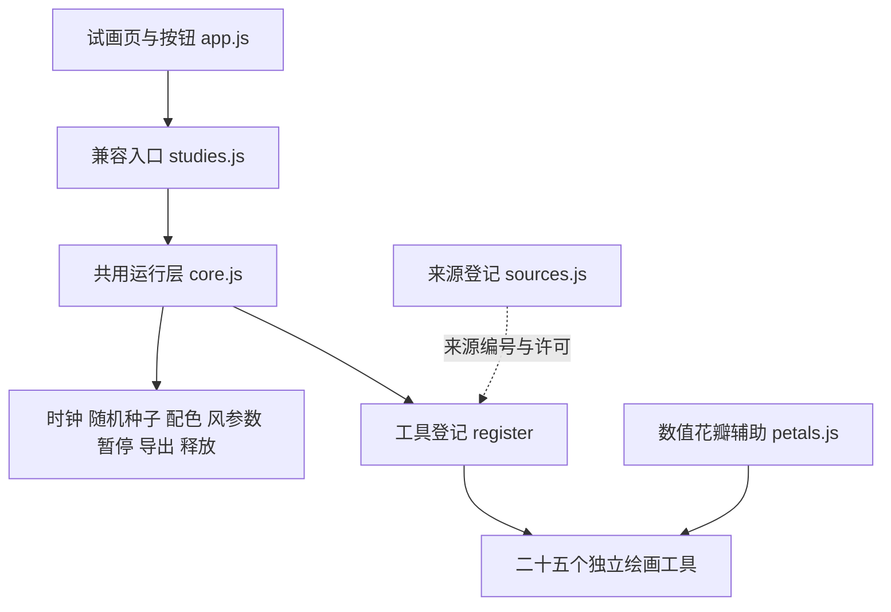

# 绘画工具结构与扩展记录

更新：2026-10-19。状态：独立试画工具层，另在[基础生成试验](../../poem-generation/README.md)中尝试模型意象到透明图层组合；完整关系与正式网页仍未贯通。

当前共有二十五种独立工具。本轮按原频次补露（2,157）、霜（1,541）、莺（1,435），新增露霜载体与单只莺形工具，并把草叶原有露霜改用共用附着层。下载原件与许可没有修改。60 个原条目的实际进度集中在 [网页总表](../progress.html)，不以工具数量充当意象完成数量。

## 结构

| 文件 | 职责 |
| --- | --- |
| `sources.js` | 原作者、来源链接、许可、保存的原文件、改动说明；本项目新写内容单独标记 |
| `core.js` | 登记与查找工具；管理每个实例的生命周期、颜色、种子、时间、共用风参数；未知工具明确报错 |
| `petals.js` | 从 sxywu 原例提取并改编的数值花瓣控制点；不生成 SVG 字符串或可执行代码 |
| `architecture.js` | 保留从原亭工具提取的折檐绘制及 MIT 归属；当前亭仍调用，楼已改用独立的写意曲面与断笔 |
| `surface-marks.js` | 共用露珠、霜纹与局部结晶绘制，只接受载体局部坐标；不自动生成载体或空中粒子 |
| `tools/*.js` | 一类绘画工具一个文件；只处理自己的几何状态、更新和绘制 |
| `../studies.js` | 兼容现有试画页面的轻量入口，无形态分支判断 |
| `check-sources.mjs` | 核对工具来源、许可和原文件；检查保存原件的 SHA-256；生成 `tool-manifest.json` |

采用普通本地脚本以继续支持双击 HTML 观看，不要求用户安装构建工具。工具通过固定代码登记，没有运行时下载、查找或执行模型生成代码的入口。

## 已有工具

| 工具 | 当前能力 | 目前边界 |
| --- | --- | --- |
| 花 `flower` | 预生成不规则贝塞尔花瓣、茎叶、风致摆动、笔触疏密；固定 7 株 | 通用花形，未实现具体花种辨识或从花枝脱落；独立落花见下 |
| 树 `tree` | 预生成递归骨架、细叶、局部风响应 | 通用树，未实现特定树种或生长过程 |
| 水 `water` | 多层水纹、风致起伏、线间疏密 | 未实现岸线、实体承载或流体物理 |
| 薄雾 `mist` | 柔边色层和局部平移 | 尚无云团细节和对实体的遮蔽机制 |
| 鸟群 `birds` | 固定 22 只，分离、对齐、聚合，固定步长更新 | 未区分鸟种；扑翼为图形试作，不是生物力学模型 |
| 舟 `boat` | 独立船体轮廓、轻微起伏；提供船首、船尾、甲板锚点 | 只有船体，不自动加人物、帆或桨；未实现真正承载关系 |
| 月 `moon` | 弯月、半月、凸月、满月、暗月；亮边可左右翻转；中心锚点 | 由观看者选择，不自动判断日期、诗句中的圆缺或建立夜景 |
| 雨 `rain` | 固定 64 条雨线，风偏移、倾斜与笔触调整 | 未实现雨滴碰撞、积水、涟漪或雪 |
| 落花 `falling-petals` | 固定 18 片花瓣，飘落、落地停留；可选循环 | 起点在空中，未实现从具体枝条脱落，不代替柳絮 |
| 石 `rock` | 单石噪声轮廓、皴线、横卧／立石；底部和顶部锚点 | 尚无山脉、石上苔草或实体支撑关系 |
| 亭 `pavilion` | 空亭、茅顶／折檐、可选栏杆；屋顶和地板锚点 | 此工具只画亭；楼有独立工具，人物与真正承载关系未实现 |
| 草及露霜 `grass` | 九簇草叶、局部风响应；可选草叶露珠或霜线 | 其他载体、地表附着与凝结过程未实现 |
| 竹 `bamboo` | 三竿竹、竹节、侧枝、窄叶簇 | 尚未区分竹种或生长过程 |
| 柳 `willow` | 一株柳形、下垂长枝与细叶 | 未做形态辨识验收或枝叶分离 |
| 雪 `snow` | 飘落雪点与静止积雪独立选择 | 未模拟逐渐累积或物体表面覆雪 |
| 红黄叶 `leaves` | 五片叶、叶脉、明确的局部红／黄叶色 | 尚无枝条附着与离枝过程 |
| 鱼 `fish` | 单鱼身体、尾鳍、鳍与眼；静止或摆尾 | 尚无鱼种、群游或水体交互 |
| 云 `cloud` | 三团结构化闭合云形、局部平移 | 尚无天气联动或跨物体遮蔽 |
| 柳絮 `catkins` | 十八团细丝轮廓，一次漂移或显式循环 | 尚无从柳树脱落或落地附着 |
| 花冠 `flower-forms` | 梅形圆瓣、菊形细长多瓣、莲形尖瓣层叠 | 仅花冠示意，未完成整株、枝叶或辨识验收 |

风目前是共用的强度参数与相位偏移方法，不是空间物理流场。月、石、亭与静止积雪不受风移动；鱼的摆尾单独选择。笔触疏密不改变这些工具的主体数量。

## 花瓣

- 原作者：sxywu；原项目：[Generative flower experiment #1](https://gist.github.com/sxywu/56728e6cf17ad249ef232c49cd9a90ad)。
- 原文件：`../code-research/flower/index.html` 的 `petalPath()`，第 77 行起；MIT 标注原件：`../code-research/flower/.block`。
- 实际改动：用数值插值替代 D3 scale，用已设种子的 p5 随机函数替代 Lodash；返回两段三次贝塞尔的控制点，翻转 Y 轴，以本地 Canvas 接口绘制。两段路径连续闭合，预先生成后复用。
- 茎叶、花群布置、纹理细线与风响应由本项目编写，不标为原作者原作。绘图时不依赖 D3、Lodash 或旧版 p5。

## 舟

- 原作者：Lingdong Huang；原项目：[Shan, Shui](https://github.com/LingDong-/shan-shui-inf)。
- 原文件：`../code-research/shan-index.html` 的 `Arch.boat01`，第 3209 行起；完整 MIT 文本：`../code-research/shan-LICENSE.txt`。
- 实际取用：船体上下边界沿长度方向使用 `sqrt(sin(πt))` 的轮廓。
- 实际改动：数值采样后直接绘制 Canvas 路径，重设吃水比例、位置、色彩与轮廓；加入甲板／船首／船尾锚点。没有复制原作中的 `Man.man` 船夫组合，也没有隐含添加桨、帆或人物。
- 轻微上下起伏是本张试画的观看设计，不说明所有诗句中的舟都在动。锚点仅提供后续连接位置，不表示已经实现载人或随水面运动。

## 月

本项目新写。用圆形外缘与椭圆明暗边界构造五种月形，默认弯月。亮边方向单独选择，满月与暗月的方向不会改变轮廓。暗月只保留极淡边缘；光晕随选定亮面比例减弱。颜色由共用配色提供，月体保持静止。这里只是形状预设，不是天文历算，也不从诗句自动判断日期、可见性或月影。

## 雨与落花

雨线的轨迹、循环与风偏移由本项目编写，没有取用外部降雨示例代码。64 条预生成雨线持续循环代表降雨；疏密只调整笔触。

落花的轮廓复用 `petals.js`，来源、MIT 证据和改动同上文“花瓣”。18 片花瓣的位置、旋转、轨迹、落地和播放模式由本项目编写。默认在约 3–6 秒完成一次飘落，落地后停留；循环仅用于显式选择的试画。暂停时切换模式不会重置种子或时间；要从头观看可点“换一组形态”。当前没有接入花枝锚点，不能声称实现了从枝条离落。

## 石与亭

来源为 Lingdong Huang 的 [Shan, Shui](https://github.com/LingDong-/shan-shui-inf)，MIT；保存原件 `../code-research/shan-index.html`，许可 `../code-research/shan-LICENSE.txt`。本轮没有额外网络下载。

- 石：改编 `Mount.rock`（原件第 2433 行起）的椭圆极径、噪声外缘、压扁底部与内缩轮廓。以圆周坐标采样 p5 噪声保证接缝闭合；轮廓预生成，Canvas 分段皴线取代原 `texture`/SVG 笔触。横卧与立石只切换比例，不重新抽样。
- 亭：改编 `Arch` 内 `hut`（第 2542 行起）的幂函数展开、`roof`（第 2840 行起）的屋脊与檐角控制点，以及 `rail` 的菱形平面关系。柱、栏杆、纹理、选择控件、锚点和 Canvas 绘制由本项目改写；没有使用 `arch01` 的随机人物，也没有把亭当作楼阁通用替身。
- 两者始终静止；笔触疏密不改变主体数量。锚点只是连接位置，不代表已实现落地碰撞或承重。

## 本轮植物与天气

草、露珠、霜线、竹、柳、雪、独立叶片、鱼与柳絮的轮廓和运动由本项目编写，登记为 `project`，没有把检索候选冒充实际复制来源。草叶上的露与霜是显式选择的载体试画；不会自动从诗句添加草。静止积雪与飘雪分开，柳絮与花瓣分开，鱼体与通用鸟群分开。

露珠与霜线使用同一片草叶的局部曲线位置，因此随叶片摆动；本轮扩展的叶面、枝条和石面见下文“露霜附着层”。红、黄叶保留局部意象色，其余轮廓与背景随共用配色变化。一次漂移、循环、静止和摆尾都是工具选项，不代替诗句时间或否定判断。

## 露霜附着层

`surface-marks.js` 为本项目编写，分别提供 `dew(ctx, drops)` 和 `frost(ctx, paths, crystals)`。所有点均为载体的局部坐标，辅助层不创建草叶、地面、计时器或随机粒子。草工具改用这一共用层，保留每片草叶一个露珠、54 片草叶的原有数量；采样位置与叶的中轴曲线一致。

`surface-weather.js` 提供叶面、枝条、石面和不补载体的局部试画，共八种露／霜组合。叶枝的旋转同时作用于载体和附着层，连接位置一起更新；石面与局部试画静止，不因风而移动。露为十八个固定局部珠点，霜为沿表面的浅色笔触与局部结晶，不画成下落雪粒。疏密只调霜的局部细节。

这是显式选择载体的观看试验；没有声称已经从诗句建立跨实体附着关系。基础生成中，单独露／霜只用局部笔触，不再默认生成草。仍缺任意花瓣与任意载体的接口、凝结、滴落、霜形成和自动附着对象匹配。

## 莺形

`oriole.js` 为本项目编写，不复制外部轮廓或鸟类图片。初版圆头、眼、足和逐根羽线过于具体，按用户反馈改为淡墨莺意：头身融为浅黄墨面，深翼、尾和喙只用几笔提示，省略眼、足、完整外轮廓和细羽，保留纸面间隙。收翅／展翅、左右朝向与展翅局部微动仍可选择。这是姿态与墨色的艺术约定，不是物种鉴定，仍待用户审美确认。

墨面由局部曲线与渐细笔触生成，几何只在固定种子重置时更新；静止模式不随帧随机抖动。用户继续反馈偏胖、展翅奇怪后，头身墨面收窄、腹部叠色减淡；两翼从各自肩部向后掠，近翼略长、远翼短而淡，微动以肩部为转轴并缩小幅度，不绕躯干中心摆动。

对照图见 `../oriole-style-comparison.png`，左为提交 `c3c6164` 的上一版淡墨画法，右为当前收瘦、调整翼姿后的试画；同一种子、配色与视图尺度。`compare-study.mjs oriole c3c6164` 可重建该本地代码对照，无模型调用。

主体固定一只，不自动加栖枝、同伴或鸣声，改变疏密不增减鸟数。默认收翅静止；微动只在显式展翅与微动同时选中时生效，是观看试验，不是完整飞行动力学。

基础映射允许明确在场的莺形；只有莺声或听闻线索时暂不画鸟体，不将夜莺、燕、雁等其他名称套入该形态。明确肯定的飞行动作才启用展翅微动，否定或未成立的动作保持静止。比喻参照和在场不明仍按原规则留空。数量和朝向均注明为本地选择。

## 花形变体

本项目新写的花冠结构示意，没有取用外部花卉图片或新复制花形代码。三种形态通过瓣宽、瓣长、瓣尖与层数区别；当前不是植物学插图，也没有完成用户辨识验收。2026-10-18 仅有花冠时，梅、菊花、莲均标为“部分支持”；本轮梅枝进展见下文。通用花仍保留已适配的 sxywu 花瓣来源，两套花形的来源不混记。

2026-10-19：梅另有下述带花枝条，单独花冠仍保留作对照；梅的总表状态改为“基础可画”。菊花、莲仍为部分支持。

## 酒液与酒器

`wine.js` 为本项目编写，无新复制来源。默认是一个酒液局部的抽象观看示意，只有液面及细纹，容器数量为零；杯中酒和酒壶是显式选项，不自动添桌面、人物或饮酒动作。杯、壶都是风格化轮廓，不主张具体历史器型。酒壶只提供壶口与底部锚点，不能把锚点当作已实现倾倒或承载。

生成映射区分明确的酒杯／酒壶和单独酒液。只有“酒”时可用酒液局部试画并明确说明这种抽象选择；“饮酒”等活动不据此补出器物。抽象、比喻参照和出现不明的实体仍由已有规则跳过。酒在总表中保留“部分支持；需语境确认”。

## 楼与共用屋顶

`building.js` 提供二层／三层楼体，固定一座楼、零个人物。第一版曾与亭共用 `architecture.js` 的折檐；用户反馈“太死板”后，楼改为曲檐墨面、渐细断笔、疏窗、淡墙和轻微错落的楼层，亭保留原样。

新楼保留原适配中屋脊与檐的组织参考，继续登记 Lingdong Huang / Shan, Shui 的 `shan-pavilion`（MIT）归属；曲面控制点、断笔宽度、墨面、窗影、楼层错落和可重复种子几何均由本项目编写，没有新增外部下载。原件和许可不改动。

楼体静止，疏密只调整屋面笔触，不改变层数与主体数量。窗影可选“疏笔”或“留白”，不再重复完整方窗格；墙面和柱线不处处封闭。相同种子的线条与断笔位置不随时间抖动。层数由显式选项控制，生成默认二层并注明本地选择；地名、典故与人物活动不因为带有“楼”字就生成一座固定楼。尚无历史建筑复原、登楼、室内活动或跨实体遮挡。

修改前后对照：`../building-style-comparison.png`；三层与窗影变体：`../building-style-variants.png`。`verify-building-style.mjs` 以提交 `d699cc1` 的首版为对照，检查 32 个种子、固定种子重复出图、静止、层数与锚点；结果见 `../building-style-verification.json`。对照是本地代码试画，不是模型生成图片。

## 梅枝

`plum-branch.js` 为本项目编写，复用本地梅形花冠的五瓣结构思想，另写曲枝、附枝花朵、花苞、风响应和连接位置。四段枝条上固定九朵花、四个花苞，横枝／短枝共享几何，整体微动同时带动花朵，连接锚点随变换更新；疏密不增减花朵数量。没有复制新的植物图片或外部形态代码。

这是风格化带花枝条，尚无整树、品种辨识、开花过程或离枝落花。生成时梅花／梅枝使用此工具；梅子仍留空，梅雨使用雨工具，不把二者误画为梅花。原单独花冠仍可从进度表打开对照。

## 结构化云形

- 原作者：Niels Pichon；[p5.Fresco / theatre/cloudGen.js](https://github.com/NielsPichon/p5.Fresco/blob/main/demos/theatre/cloudGen.js)，Apache-2.0。
- 保存原件：`../code-research/fresco/demos/theatre/cloudGen.js`；完整许可：`../code-research/fresco/LICENSE`。
- 实际取用：`createCloud` 的圆弧、S 路径、水平段、闭合与归一化，及相关点操作辅助。
- 改动：绑定实例内 p5 随机与向量；返回数值点而非 `Fresco.Shape`；递归重试改为最多 13 次；去除随机配色与边框放置；增加高度限制，样式、位置和风响应由本项目提供。运行时不加载 Fresco 库。
- `prepare-cloud.py` 从保存原件重建 `cloud-outline.js`，生成文件保留改编和许可说明。薄雾与结构化云形分别登记，不互称已完成。

## 进度维护

`../progress-records.json` 是 60 项进度的唯一人工编辑入口；`../organize-catalog.py` 校验条目、来源工具与选项，生成目录总表、网页数据和汇总数字。不要手工改 `progress-data.js` 或生成后的目录来调整进度。表中“需语境确认”和“绘画进度”分开，不能用歧义标记代替能力检查。

## 工具约定

新工具通过 `PoemDrawing.register` 登记 `id`、名称、`sources` 和 `create(ctx)`。来源编号必须已在 `sources.js` 中存在；不能只留“参考网络”。`capabilities` 记录实际提供的能力，不把计划功能登记为完成。

`create(ctx)` 返回：

- `reset()`：在运行层设定种子并归零时间后创建几何状态。
- `update(dt)`：可选；只更新该实例的状态。鸟群在此执行固定步长运动。
- `draw()`：读取当前配色、风参数和时间绘制，不修改其他工具。
- `inspect()`：用于检查主体数量、几何摘要与数值状态。
- `anchors()`：可选；返回具名连接位置，目前舟和月已提供。
- `dispose()`：可选；清理工具自己新增的资源。

上下文含 `p`、`width`、`height`、`settings`、`options`、`time`、`palette`、透明色辅助和 `wind`。逻辑画布为 **640×388**，锚点也是该逻辑画布坐标；屏幕适配暂由 CSS 完成，并非已经支持任意构图尺度。

运行层返回 `pause`、`refresh`、`configure`、`reset`、`save`、`inspect`、`anchors`、`dispose`。每个实例有独立种子、时钟、颜色缓存和工具状态。暂停时修改配色或参数仍能重绘；释放后移除画布，避免后续反复挂载积累实例。

`mount(id, host, shared, seed, {transparent:true})` 可供组合试验渲染透明图层；省略第五参数时仍绘制原有背景。`paletteFor(name)` 返回共用配色，组合画布无需另造颜色表。透明图层不代表已实现物理遮蔽或水面承载。

工具可声明 `controls`（选项编号、标签、默认值和允许值）；页面自动生成各工具的选择框。`configure(patch)` 先验证整组参数，拒绝未知编号或值，再更新该实例的 `ctx.options`，不会修改其他工具或全局参数。

绘画前后保存／恢复 p5 绘图状态；半透明颜色按颜色和整数透明度缓存，减少重复创建。这里没有宣称已测得特定帧率或性能提升。

## 逐步扩展流程

1. 有检索来源时，保存可运行原件及许可，加入来源记录；若取用其中一部分，记下函数和改动边界。
2. 在 `tools/` 添加独立文件，用当前数值参数与本地代码登记；不修改核心文件里的形态分支，因为核心没有此类分支。
3. 在试画入口增加本地脚本引用。预计算几何，区分状态更新与绘制，声明是否提供锚点。
4. 检查来源、固定种子的重置、暂停和配色、主体数量、实例隔离、释放资源、导出与画面。
5. 通过后更新工具清单与意象目录，再决定是否接入组合场景。

扩展按原表频次从高到低推进，已有基础形态暂不反复打磨；下一批先处理兰（1,316）、马（1,280）、莲（600）。风已有共用作用参数，空间风场属于后续作用关系工作。歧义与非物体先记录去向，不因测试诗句需要就插入低频项。进度随实际能力更新，不能只因找到来源就升级。

## 本轮验证

`node experiments/imagery-library/drawing/check-sources.mjs` 检查二十五个登记工具、九项来源记录，以及 49 个保存来源／依赖文件的哈希。登记清单见 `tool-manifest.json`；脚本还检查每个工具文件都实际加载并登记。

`node experiments/imagery-library/verify.mjs` 用本机 Edge 检查全部登记画布、暂停／恢复、换种子、配色、PNG 数据导出、固定主体数量、各工具暂停重置后的重复出图、选项画面区分、五种月形与亮边翻转、落花落地停留与显式循环、非法参数拒绝、静止工具与锚点、实例隔离及释放、390 像素窄屏布局。结果见 `../verification.json`。

本轮另检查酒液不含容器、杯壶不含人物、楼层／门窗切换、楼体静止、梅枝风响应、花苞数量与锚点。九格预览见 `../frequency-tools-preview.png`；三层离线组合见 `../frequency-composition.png` 和 JSON，样例明确标记为本地手工语义，模型调用次数为零。

露霜与莺形检查包括八种露霜／载体组合的实际画面区分、附着点随叶枝共同变换、石面静止、不补载体的局部模式、鸟形左右翻转、展翅微动及收翅保持静止。预览见 `../surface-bird-preview.png`，结果见 `../verification.json` 的 `surfaceBirdFeatures`。这些功能检查不代替莺形的物种辨识或用户审美判断。

`node experiments/imagery-library/verify-progress.mjs` 检查进度页的 60 个原词与降序频次、四类进度汇总、关键词／进度／语境筛选、空结果、窄屏表内滚动，以及露、霜、莺、黄叶、酒、楼、梅能否打开正确的试画选项。结果见 `../progress-verification.json`。以上不代替全部设备的性能测试或文学与审美验收。

已有基础生成试验将选定工具叠到同一张画布，但位置、比例和图层次序仍是本地试验规则。承载、遮蔽、完整关系与六指标驱动未实现，也没有修改冻结的接口协议 3.0。
