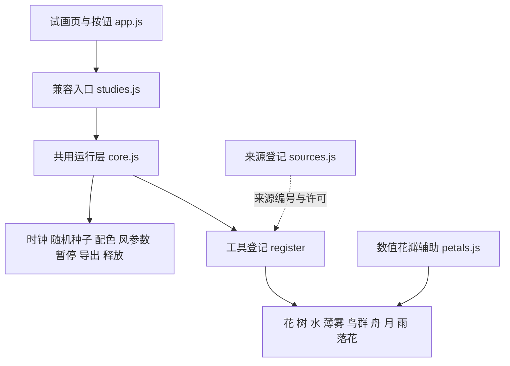

# 绘画工具结构与扩展记录

更新：2026-10-18。状态：独立试画工具层，尚未接入正式固定诗句网页或语义协议。

当前共有九种独立工具。本轮将月体扩展为五种可选月形，增加雨线与落花；落花复用已保存来源的 sxywu 花瓣算法。下载原件与许可没有修改。

## 结构

| 文件 | 职责 |
| --- | --- |
| `sources.js` | 原作者、来源链接、许可、保存的原文件、改动说明；本项目新写内容单独标记 |
| `core.js` | 登记与查找工具；管理每个实例的生命周期、颜色、种子、时间、共用风参数；未知工具明确报错 |
| `petals.js` | 从 sxywu 原例提取并改编的数值花瓣控制点；不生成 SVG 字符串或可执行代码 |
| `tools/*.js` | 一类绘画工具一个文件；只处理自己的几何状态、更新和绘制 |
| `../studies.js` | 兼容现有试画页面的轻量入口，无形态分支判断 |
| `check-sources.mjs` | 核对工具来源、许可和原文件；检查保存原件的 SHA-256；生成 `tool-manifest.json` |

采用普通本地脚本以继续支持双击 HTML 观看，不要求用户安装构建工具。工具通过固定代码登记，没有运行时下载、查找或执行模型生成代码的入口。

## 已有工具

| 工具 | 当前能力 | 目前边界 |
| --- | --- | --- |
| 花 `flower` | 预生成不规则贝塞尔花瓣、茎叶、风致摆动、笔触疏密；固定 7 株 | 通用花形，未实现具体花种辨识或从花枝脱落；独立落花见下 |
| 树 `tree` | 预生成递归骨架、细叶、局部风响应 | 通用树，未实现特定树种或生长过程 |
| 水 `water` | 多层水纹、风致起伏、线间疏密 | 未实现岸线、实体承载或流体物理 |
| 薄雾 `mist` | 柔边色层和局部平移 | 尚无云团细节和对实体的遮蔽机制 |
| 鸟群 `birds` | 固定 22 只，分离、对齐、聚合，固定步长更新 | 未区分鸟种；扑翼为图形试作，不是生物力学模型 |
| 舟 `boat` | 独立船体轮廓、轻微起伏；提供船首、船尾、甲板锚点 | 只有船体，不自动加人物、帆或桨；未实现真正承载关系 |
| 月 `moon` | 弯月、半月、凸月、满月、暗月；亮边可左右翻转；中心锚点 | 由观看者选择，不自动判断日期、诗句中的圆缺或建立夜景 |
| 雨 `rain` | 固定 64 条雨线，风偏移、倾斜与笔触调整 | 未实现雨滴碰撞、积水、涟漪或雪 |
| 落花 `falling-petals` | 固定 18 片花瓣，飘落、落地停留；可选循环 | 起点在空中，未实现从具体枝条脱落，不代替柳絮 |

风目前是共用的强度参数与相位偏移方法，不是空间物理流场。月体不受风移动。笔触疏密不改变花、鸟或舟的主体数量。

## 花瓣

- 原作者：sxywu；原项目：[Generative flower experiment #1](https://gist.github.com/sxywu/56728e6cf17ad249ef232c49cd9a90ad)。
- 原文件：`../code-research/flower/index.html` 的 `petalPath()`，第 77 行起；MIT 标注原件：`../code-research/flower/.block`。
- 实际改动：用数值插值替代 D3 scale，用已设种子的 p5 随机函数替代 Lodash；返回两段三次贝塞尔的控制点，翻转 Y 轴，以本地 Canvas 接口绘制。两段路径连续闭合，预先生成后复用。
- 茎叶、花群布置、纹理细线与风响应由本项目编写，不标为原作者原作。绘图时不依赖 D3、Lodash 或旧版 p5。

## 舟

- 原作者：Lingdong Huang；原项目：[Shan, Shui](https://github.com/LingDong-/shan-shui-inf)。
- 原文件：`../code-research/shan-index.html` 的 `Arch.boat01`，第 3209 行起；完整 MIT 文本：`../code-research/shan-LICENSE.txt`。
- 实际取用：船体上下边界沿长度方向使用 `sqrt(sin(πt))` 的轮廓。
- 实际改动：数值采样后直接绘制 Canvas 路径，重设吃水比例、位置、色彩与轮廓；加入甲板／船首／船尾锚点。没有复制原作中的 `Man.man` 船夫组合，也没有隐含添加桨、帆或人物。
- 轻微上下起伏是本张试画的观看设计，不说明所有诗句中的舟都在动。锚点仅提供后续连接位置，不表示已经实现载人或随水面运动。

## 月

本项目新写。用圆形外缘与椭圆明暗边界构造五种月形，默认弯月。亮边方向单独选择，满月与暗月的方向不会改变轮廓。暗月只保留极淡边缘；光晕随选定亮面比例减弱。颜色由共用配色提供，月体保持静止。这里只是形状预设，不是天文历算，也不从诗句自动判断日期、可见性或月影。

## 雨与落花

雨线的轨迹、循环与风偏移由本项目编写，没有取用外部降雨示例代码。64 条预生成雨线持续循环代表降雨；疏密只调整笔触。

落花的轮廓复用 `petals.js`，来源、MIT 证据和改动同上文“花瓣”。18 片花瓣的位置、旋转、轨迹、落地和播放模式由本项目编写。默认在约 3–6 秒完成一次飘落，落地后停留；循环仅用于显式选择的试画。暂停时切换模式不会重置种子或时间；要从头观看可点“换一组形态”。当前没有接入花枝锚点，不能声称实现了从枝条离落。

## 工具约定

新工具通过 `PoemDrawing.register` 登记 `id`、名称、`sources` 和 `create(ctx)`。来源编号必须已在 `sources.js` 中存在；不能只留“参考网络”。`capabilities` 记录实际提供的能力，不把计划功能登记为完成。

`create(ctx)` 返回：

- `reset()`：在运行层设定种子并归零时间后创建几何状态。
- `update(dt)`：可选；只更新该实例的状态。鸟群在此执行固定步长运动。
- `draw()`：读取当前配色、风参数和时间绘制，不修改其他工具。
- `inspect()`：用于检查主体数量、几何摘要与数值状态。
- `anchors()`：可选；返回具名连接位置，目前舟和月已提供。
- `dispose()`：可选；清理工具自己新增的资源。

上下文含 `p`、`width`、`height`、`settings`、`options`、`time`、`palette`、透明色辅助和 `wind`。逻辑画布为 **640×388**，锚点也是该逻辑画布坐标；屏幕适配暂由 CSS 完成，并非已经支持任意构图尺度。

运行层返回 `pause`、`refresh`、`configure`、`reset`、`save`、`inspect`、`anchors`、`dispose`。每个实例有独立种子、时钟、颜色缓存和工具状态。暂停时修改配色或参数仍能重绘；释放后移除画布，避免后续反复挂载积累实例。

工具可声明 `controls`（选项编号、标签、默认值和允许值）；页面自动生成各工具的选择框。`configure(patch)` 先验证整组参数，拒绝未知编号或值，再更新该实例的 `ctx.options`，不会修改其他工具或全局参数。

绘画前后保存／恢复 p5 绘图状态；半透明颜色按颜色和整数透明度缓存，减少重复创建。这里没有宣称已测得特定帧率或性能提升。

## 逐步扩展流程

1. 有检索来源时，保存可运行原件及许可，加入来源记录；若取用其中一部分，记下函数和改动边界。
2. 在 `tools/` 添加独立文件，用当前数值参数与本地代码登记；不修改核心文件里的形态分支，因为核心没有此类分支。
3. 在试画入口增加本地脚本引用。预计算几何，区分状态更新与绘制，声明是否提供锚点。
4. 检查来源、固定种子的重置、暂停和配色、主体数量、实例隔离、释放资源、导出与画面。
5. 通过后更新工具清单与意象目录，再决定是否接入组合场景。

下一批可考虑从已取得的山水代码中拆岩石、亭阁，从 Fresco 中拆结构化云形。它们已有可研究源码，但**本轮没有完成独立适配**，不计入九个已登记工具。

## 本轮验证

`node experiments/imagery-library/drawing/check-sources.mjs` 检查九个登记工具、六项来源记录，以及 49 个保存来源／依赖文件的哈希。登记清单见 `tool-manifest.json`。

`node experiments/imagery-library/verify.mjs` 用本机 Edge 检查九画布、暂停／恢复、换种子、配色、PNG 数据导出、固定主体数量、九类工具暂停重置后的重复出图、五种月形画面区分、亮边翻转、落花落地停留与显式循环、非法参数拒绝、月体双实例同种子对照、实例隔离及释放、390 像素窄屏布局。结果见 `../verification.json`；不代替全部设备的性能测试或文学与审美验收。

这仍是独立工具试验：尚未实现跨工具的同场景分层、承载、遮蔽和语义驱动，也没有更改接口协议 3.0。
